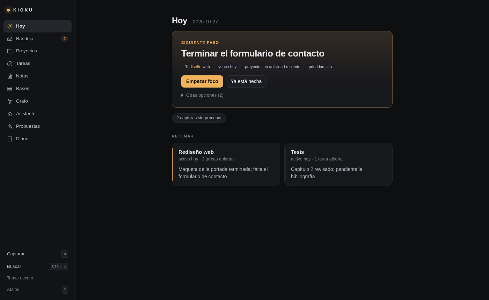
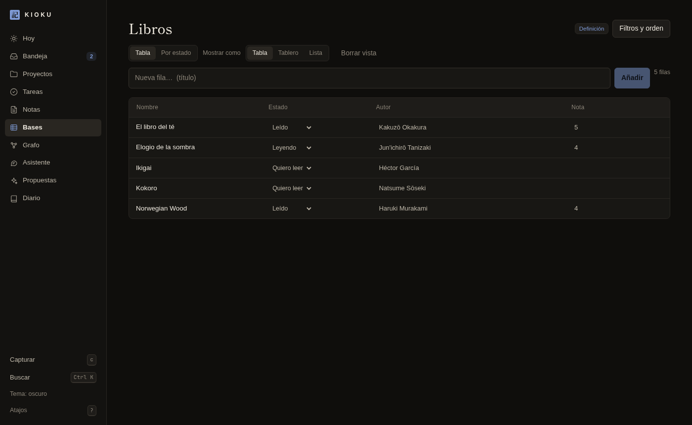
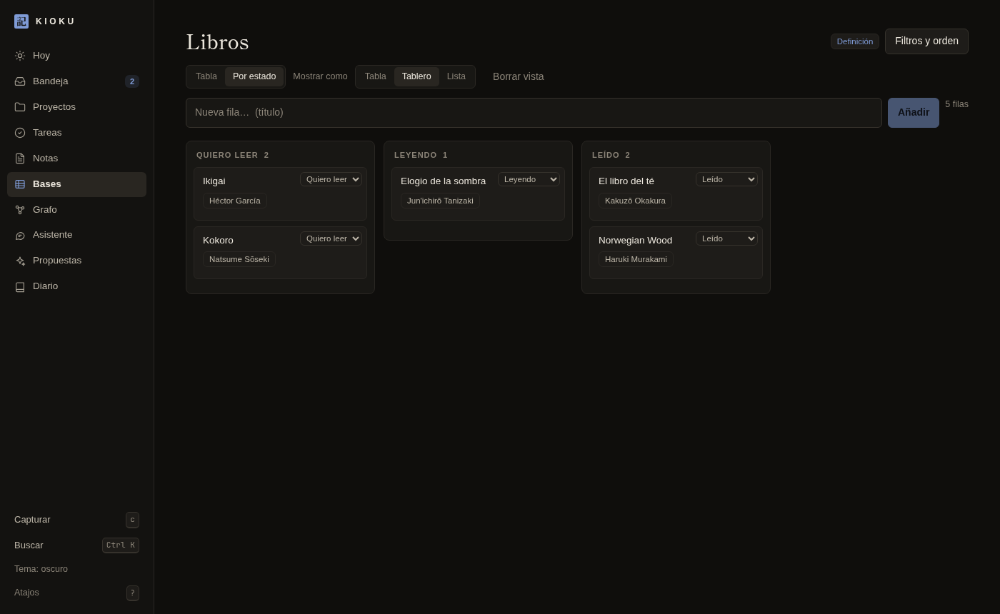
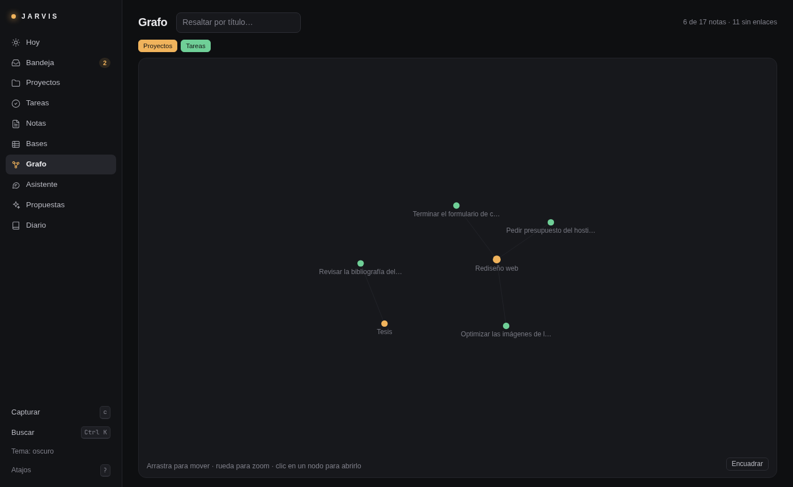

<div align="center">

# Kioku

**Tu segundo cerebro, local y tuyo.**
Notas en Markdown, tareas, proyectos y bases de datos al estilo Notion, con un asistente que propone y tú apruebas.

[](CHANGELOG.md)
[](LICENSE)
[](https://nodejs.org)
[](#privacidad-y-seguridad)
[](#desarrollo)



</div>

## Qué es

Kioku está pensado para quien ya tiene (o quiere tener) sus notas en ficheros y no quiere depender de un servicio en la nube. Resuelve tres problemas cotidianos:

| Problema | Cómo lo resuelve |
|---|---|
| *«Empiezo el día y hay demasiadas opciones.»* | La pantalla **Hoy** te dice por dónde empezar, con las razones (vence hoy, prioridad alta, proyecto activo…). |
| *«Trabajando, me desvío.»* | Las **sesiones de foco** fijan lo que haces; lo que se te ocurre va a la **Bandeja** sin cambiar de contexto. |
| *«Vuelvo tras unos días y no recuerdo dónde iba.»* | La tarjeta **Retomar** de cada proyecto: dónde lo dejaste, qué decidiste y qué falta. |

Además trae **bases de datos** (tabla, tablero y lista sobre tus propias notas), un **grafo** de enlaces y un **asistente** de IA que organiza por ti, pero nunca hace nada destructivo sin que lo apruebes.

### Principios

- **Tus datos son ficheros.** Markdown con frontmatter YAML en una carpeta. Se leen y se editan con cualquier editor (incluido Obsidian).
- **El índice es desechable.** Una base SQLite derivada que puedes borrar: se reconstruye sola desde los ficheros.
- **Local por defecto.** El servidor solo escucha en `127.0.0.1`. Sin cuentas, sin telemetría, sin nube obligatoria.
- **La IA propone, tú decides.** Todo cambio que no sea pequeño y reversible pasa por una propuesta con su diff.
- **Sin estado opaco.** Lo que «sabe» el asistente está en ficheros de texto que puedes leer y borrar.

## Capturas

<table>
  <tr>
    <td width="50%"><br><sub><b>Bases · Tabla</b> con propiedades tipadas editables en la propia celda.</sub></td>
    <td width="50%"><br><sub><b>Bases · Tablero</b>: arrastra tarjetas entre columnas y se reescribe la propiedad.</sub></td>
  </tr>
  <tr>
    <td colspan="2"><br><sub><b>Grafo</b> de enlaces entre proyectos, tareas y notas.</sub></td>
  </tr>
</table>

## Instalación

### Instalación rápida (un comando, macOS y Linux)

```bash
curl -fsSL https://raw.githubusercontent.com/EzequielMenor/kioku/main/scripts/install.sh | bash
```

Instala Kioku completo con la **gestión de dispositivos por Tailscale**, **Kio** integrado en la app y el **motor nativo del agente** (listo para Ollama y modelos locales o compatibles con OpenAI sin Docker).

- **macOS:** descarga un Node 24+ oficial verificado, compila la app en `~/Applications/Kioku.app` y la abre directamente en **Conexiones y sincronización** (sin necesidad de Node ni Docker previos; la primera vez macOS puede pedir clic derecho > Abrir porque la app no está firmada). También puedes descargar el [ZIP de `main`](https://codeload.github.com/EzequielMenor/kioku/zip/main), extraerlo y hacer doble clic en **`Instalar Kioku.command`**.
- **Linux:** instala en `~/.local/share/kioku`, añade el comando `kioku` en `~/.local/bin` (incluyendo un Node 24 privado si no lo tienes instalado), ofrece activar el servicio de usuario `systemd` y abre **Conexiones y sincronización**.

### Actualizar

Desde el propio ordenador (en **macOS** y en **Linux**), Kioku comprueba automáticamente de forma discreta el historial público de `main` en GitHub (sin enviar ningún dato tuyo). Si hay cambios nuevos, muestra un aviso en la parte superior y en **Conexiones y sincronización** (`Actualizaciones`) con dos botones: **Buscar actualizaciones** y **Actualizar ahora**, que descarga la nueva versión, guarda la copia `.anterior-...` de respaldo y reinicia Kioku por ti.

Si prefieres actualizar desde terminal (o tienes una versión anterior al detector), vuelve a ejecutar el mismo instalador añadiendo `--yes` para aceptar el reemplazo sin confirmación:

```bash
curl -fsSL https://raw.githubusercontent.com/EzequielMenor/kioku/main/scripts/install.sh | bash -s -- --yes
```

Qué pasa al actualizar:
- **Tus datos no se tocan:** mantiene intactas tus notas (`~/Library/Application Support/Kioku/Workspace` en macOS o `${KIOKU_HOME:-~/Documents/Kioku}` en Linux), tus claves, tus conversaciones y tus dispositivos emparejados.
- **Reemplazo seguro:** compila primero la nueva versión en una carpeta temporal y, solo cuando está lista, aparta la anterior como copia de respaldo (`Kioku.app.anterior-...` en macOS o `~/.local/share/kioku.anterior-...` en Linux). Si falla cualquier descarga o comprobación, deja intacta tu versión actual.
- **Reiniciar la app/servicio si estaba en marcha:** en **macOS**, cierra `Kioku.app` si ya estaba abierta antes de volver a abrirla; en **Linux**, si usabas el servicio automático, reinícialo con `systemctl --user restart kioku.service` (o reinicia tu daemon si lo lanzabas manualmente). Puedes borrar la copia `.anterior-...` cuando compruebes que todo va bien.
- **Si instalaste desde un clon de Git (`git clone`):** actualiza dentro de tu carpeta con `git pull && npm ci && npm run build:web`. Si administras manualmente una unidad `systemd` en Linux, tienes el procedimiento paso a paso con vuelta atrás en [docs/upgrade-and-recovery.md](docs/upgrade-and-recovery.md).

### Requisitos (si instalas desde código)

| | Necesario | Para qué |
|---|---|---|
| **Node.js ≥ 24** | Sí | Ejecuta el servidor y la CLI (usa `node:sqlite`, sin dependencias nativas). En la instalación rápida se descarga automáticamente si falta. |
| **Chromium, Chrome o Brave** | Recomendado | Abre la interfaz como ventana de aplicación. Sin él puedes abrir la URL del daemon en cualquier navegador. |
| **[Ollama](https://ollama.com)** (u otro endpoint OpenAI local) | Opcional | Asistente local directo con el motor nativo, sin Hermes ni Docker ([guía](docs/assistant-local.md)). |
| **[Hermes Agent](https://github.com/NousResearch/hermes-agent)** con `bwrap` (Linux) o Docker Desktop (Mac) | Opcional | Solo si usas Codex u otras APIs remotas con Hermes; [modelos](docs/assistant-models.md) y [Mac](docs/assistant-macos.md). |
| **GTK4 + `gtk4-layer-shell` + PyGObject** (solo Linux Wayland) | Opcional | Solo para sacar a **Kio** flotando sobre el escritorio con `kioku companion` ([guía](docs/companion.md)). Dentro de Kioku ya funciona sin instalar nada. |

Desarrollado y probado en **Arch Linux / Omarchy con Hyprland** y validado en **macOS (Apple Silicon e Intel)**. Para usarlo a diario en el Mac, con Kio en el escritorio, arranque con launchd y Ollama local, consulta [Kioku en macOS](docs/macos.md). La app Mac anterior, que abre Kioku en el navegador, se describe en la [guía de Mac](docs/macos-app.md). Para el despliegue privado con Dokploy, consulta la [guía de Dokploy](docs/dokploy.md). Windows no está probado.

### Desde el código fuente

```bash
# 1. Descarga el proyecto
git clone https://github.com/EzequielMenor/kioku.git
cd kioku

# 2. Instala las dependencias y compila la interfaz web
npm install
npm run build:web

# 3. (Opcional) haz el comando disponible desde cualquier carpeta
mkdir -p ~/.local/bin
ln -s "$PWD/bin/kioku" ~/.local/bin/kioku      # asegúrate de que ~/.local/bin está en tu PATH

# 4. Comprueba que funciona
kioku add "t Probar Kioku !hoy"
kioku today
kioku open                                       # abre el Workspace
kioku url                                        # URL de acceso con la clave (para abrirla en otro navegador)
```

Si no haces el paso 3, usa `bin/kioku` desde la carpeta del proyecto.

### Conectar tus dispositivos

Desde la propia aplicación, abre **Conexiones y sincronización** en la barra lateral (o `kioku open /conexiones`):

1. **Activar acceso privado** con **Tailscale** (con un clic configura `tailscale serve` en HTTPS dentro de tu tailnet, sin abrir puertos del router ni usar Funnel).
2. **Añadir dispositivo** genera un código QR y un enlace de un solo uso para vincular cada móvil o tablet con su propio nombre.
3. **Desconectar** permite revocar el acceso de un dispositivo concreto en cualquier momento.

El ordenador debe permanecer encendido; no hay sincronización garantizada en segundo plano. Más detalles en la [guía de conexiones](docs/connections.md) y en la [API de acceso por dispositivo](docs/device-access-api.md).

### Activar el asistente y a Kio tras instalar

1. **Kio dentro de Kioku:** ya viene activado al instalar tanto en **macOS** como en **Linux** (pulsa `.` o haz clic en su personaje en la esquina inferior derecha).
2. **Kio flotando en el escritorio (opcional, solo Linux Wayland/Hyprland/Sway):**
   ```bash
   sudo pacman -S --needed gtk4 gtk4-layer-shell python-gobject python-cairo
   kioku companion
   ```
   En macOS, GNOME o X11, Kio vive integrado dentro de Kioku ([guía del compañero](docs/companion.md)).
3. **Modelo local con Ollama (sin Hermes ni Docker):** instala [Ollama](https://ollama.com), descarga un modelo que admita herramientas (recomendado y probado: `ollama pull qwen3.5:9b`), abre en Kioku la paleta de comandos (`Ctrl+K` → «Modelo de Kio») y selecciona **Ollama (local)**. Kioku pide a Ollama 16.384 tokens de contexto por su cuenta (el valor por defecto de Ollama, 4.096, no da ni para las herramientas de Kio); qwen3.5:9b ocupa así unos 6,6 GB. Si Ollama corre en otro equipo de tu red privada, conéctalo por Tailscale con [la guía de modelo local](docs/assistant-local.md) y compruébalo con `kioku assistant status`.
4. **Codex u otras APIs remotas (opcional):** usa [Hermes Agent](docs/assistant-models.md) (`bwrap` en Linux o [Docker Desktop en Mac](docs/assistant-macos.md)).

### Dónde se guardan tus datos

Por defecto en **`~/Documents/Kioku`**. Cámbialo con la variable `KIOKU_HOME`:

```bash
export KIOKU_HOME=~/mi-cerebro        # por ejemplo, en tu ~/.bashrc
```

> **Importante:** Kioku se niega a usar como carpeta de trabajo una que parezca una bóveda de Obsidian (`.obsidian`) para no modificarla. Si ya usas Obsidian, deja tu bóveda donde está e [impórtala](#importar-desde-obsidian) como copia.

### Atajo de teclado para la captura rápida (Hyprland / Omarchy)

Añade esto **tú** a `~/.config/hypr/bindings.lua` (Kioku nunca toca tu configuración). Hay un ejemplo en [`contrib/hyprland-bind.lua`](contrib/hyprland-bind.lua):

```lua
o.bind("SUPER + N",       "Kioku Quick",     "/ruta/a/kioku/bin/kioku quick")
o.bind("SUPER + ALT + N", "Kioku Workspace", "/ruta/a/kioku/bin/kioku open")
```

Comprueba antes que esas teclas estén libres con `omarchy menu keybindings --print`.

Para Kio en el escritorio (`kioku companion`, `kioku companion panel`, `kioku companion toggle`) hay atajos de ejemplo en la [guía del compañero](docs/companion.md).

### Arranque automático (opcional)

```bash
kioku service install      # servicio de usuario de systemd; arranca con tu sesión
kioku service status
kioku service uninstall
```

## Uso

### Captura: escribir sin pensar dónde va

Pulsa tu atajo (o `c` dentro del Workspace) y escribe. El **prefijo** decide qué se crea; sin prefijo, va a la **Bandeja** para clasificarla después.

| Escribes | Resultado |
|---|---|
| `t Llamar a Ana !mañana @Tesis p1` | Tarea con fecha (`!hoy`, `!mañana`, `!viernes`…), proyecto (`@`) y prioridad (`p1`–`p3`) |
| `d Usar Markdown para el blog @[Rediseño web]` | Decisión anotada en el proyecto (si el nombre tiene espacios, entre corchetes) |
| `n Resumen de la reunión` | Nota |
| `/ presupuesto` | Búsqueda |
| `a: ¿qué hago hoy?` | Pregunta al asistente |
| *cualquier otra cosa* | Captura en la Bandeja |

Lo mismo desde la terminal, sin abrir ventana: `kioku add "t Llamar a Ana !mañana @Tesis p1"`.

### El flujo diario

1. **Hoy** (`g h`): la tarjeta *Siguiente paso* sugiere una tarea y explica por qué. `Empezar foco` la activa.
2. **Foco**: mientras dura, lo que captures queda aparcado en la Bandeja para después. Termina con `kioku focus end -m "dónde lo dejas"` (o `--done`).
3. **Retomar**: al volver a un proyecto verás *Lo dejaste en / Decidiste / Falta*.
4. **Bandeja** (`g b`): convierte las capturas en tarea o nota con un clic, o deja que las clasifique el asistente.

### Bases de datos

Entra en **Bases** (`g d`) para reunir notas como filas de una tabla. Eliges de dónde salen (una carpeta, un tipo de nota o etiquetas) y obtienes:

- **Propiedades tipadas:** texto, número, fecha, casilla, selección, selección múltiple, URL y relación. El tipo se deduce de los valores o lo fijas tú.
- **Estructura editable desde la tabla** (escritorio): el botón **+** de la última columna añade una propiedad; el menú de cada cabecera renombra, cambia el tipo, ordena, oculta o borra la propiedad. Si el cambio reescribe notas se pide confirmación y después puedes **Deshacer**. En el móvil la estructura es de solo lectura.
- **Opciones con color:** en las propiedades de selección editas las opciones (renombrar, reordenar, borrar y, en la selección simple, color de una paleta de 8; la multiselección no pinta colores). La celda es un chip de color con un selector que filtra y ofrece **Crear «…»** cuando lo escrito no existe.
- **Tres vistas:** Tabla, Tablero (arrastrar y soltar entre columnas) y Lista.
- **Filtros, orden, agrupación y columnas**, y **vistas guardadas** por base.
- **Plantillas** para empezar: vacía, tareas, proyectos y libros.

Todo es Markdown: la base es `Bases/<Nombre>.md`, las filas son notas normales y cada celda es una propiedad de su frontmatter. Por eso también se ven y se editan en Obsidian o con cualquier editor. Cada nota muestra y edita sus propiedades en el panel lateral.

```yaml
# Bases/Libros.md
type: database
source: { folder: "Libros/" }
properties:
  Estado: { type: select, options: [Quiero leer, Leyendo, Leído] }
views:
  - { name: Por estado, kind: board, group: Estado }
```

### Atajos del Workspace

| Tecla | Acción |
|---|---|
| `Ctrl+K` | Paleta: buscar y ejecutar comandos |
| `c` | Capturar |
| `g h` · `g b` · `g p` · `g t` · `g n` · `g d` · `g g` · `g a` · `g r` | Ir a Hoy · Bandeja · Proyectos · Tareas · Notas · Bases · Grafo · Asistente · Propuestas |
| `?` | Ayuda de atajos |

### Importar desde Obsidian

Tu bóveda **no se toca**. La importación hace una *copia de solo lectura* del origen:

```bash
kioku import-obsidian ~/Documents/MiBoveda          # solo informa de lo que haría
kioku import-obsidian ~/Documents/MiBoveda --yes    # copia a KIOKU_HOME (en Notas/Importado/)
```

### Copias de seguridad

Tu carpeta ya es la copia de seguridad (son ficheros). Además:

```bash
kioku export ~/respaldo.tar.gz
kioku restore ~/respaldo.tar.gz ~/carpeta-nueva
```

## Asistente

Es opcional y la forma más cómoda de organizar el espacio: pídele que clasifique la Bandeja, que revise enlaces rotos o que te diga qué hacer hoy. Se abre en la pestaña **Asistente** (`g a`), con `kioku ask "…"` o con `a:` en Quick.

- **Motor:** dos, detrás de un mismo asistente. Con un modelo local ([Ollama](docs/assistant-local.md) o cualquier endpoint compatible con OpenAI) Kioku habla con él directamente y tus notas no salen de tus equipos; con Codex (por defecto) u otras APIs lo atiende [Hermes Agent](https://github.com/NousResearch/hermes-agent) en una jaula (`bwrap` en Linux; [Docker en Mac](docs/assistant-macos.md), pendiente de validación real en macOS). [Proveedor y modelo son configurables](docs/assistant-models.md). `kioku assistant status` te dice qué motor, proveedor y modelo están activos y si están listos.
- **Kio, tu compañero:** el asistente tiene cara. Flota dentro de Kioku (tecla `.`) y también sobre tu escritorio: en Hyprland/Omarchy con `kioku companion`, y en macOS con [Kioku.app](docs/macos.md). Es el mismo agente en los dos sitios: misma conversación, mismo estado, mismos modos (visible, concentración, oculto). [Guía del compañero](docs/companion.md).
- **Centro de Kioku:** organiza y ayuda a pensar; responde preguntas generales sin leer notas innecesariamente y no reescribe tus notas sin petición explícita. Los cambios críticos requieren propuestas que tú apruebas.
- **Desde el móvil:** [Más → Asistente](docs/assistant-mobile.md), con el ordenador encendido, sin suspensión y accesible por la conexión emparejada. Puede proponer cambios y pedir aprobación allí mismo; no hay chat sin conexión ni cola de preguntas. Su memoria y conversaciones no comparten datos privados del escritorio.
- **Qué hace solo:** lo pequeño y reversible (clasificar capturas, consultar tus bases, añadirles filas). Cada acción queda con un botón **Deshacer** (`kioku assistant actions` · `kioku assistant undo <id>`).
- **Qué te pide aprobar:** borrar, mover o tocar más de 5 notas, o escribir contenido externo, se convierte en una **propuesta** con diff (`kioku proposals`).
- **Qué ve:** solo lo que lee a través de las herramientas de Kioku; nunca monta tu bóveda. Puedes excluir carpetas en `.kioku/assistant.json`: `{"exclude": ["Privado/"]}`. `Notas/Importado/` es de solo lectura para él.
- **Calendario:** puede ver tu agenda (`list_events`: «¿qué tengo mañana?») y apuntar eventos o bloques (`create_event`: «dentista el jueves de 17 a 18»); crear un evento es reversible con **Deshacer**. Solo el portátil usa el asistente; el móvil no.
- **Qué recuerda:** texto plano en `.kioku/hermes/` (pantalla *Memoria*); puedes borrarlo.

> El texto de las notas que el asistente lee **se envía al proveedor del modelo**. Cada consulta queda registrada con las notas leídas. Si no quieres eso, no lo actives: el resto de Kioku funciona sin él.

### IA propia (opcional)

Para triaje con tu propio modelo, local (Ollama) o remoto compatible con la API de OpenAI:

```bash
kioku ai config http://127.0.0.1:11434/v1 <modelo>        # local
kioku ai config https://api.ejemplo.com/v1 <modelo> MI_VARIABLE_CON_LA_CLAVE   # remoto
kioku ai preview          # muestra EXACTAMENTE qué se enviaría
kioku ai triage --yes     # solo entonces se envía; el resultado son propuestas
```

La clave nunca se guarda en disco: solo el nombre de la variable de entorno que la contiene.

## Avisos de tareas y eventos

Kioku te avisa mientras el daemon corre (con `kioku service install` arranca con tu sesión):

- **Eventos y bloques del calendario:** un aviso unos minutos antes del inicio (10 por defecto).
- **Tareas:** un resumen al empezar el día (a las 9:00 por defecto) con las tareas que vencen hoy o ya vencidas.
- Cada aviso sale **una sola vez** por canal (el registro vive en `.kioku/notify-*.json` y sobrevive a reinicios). Si el portátil está apagado o dormido, no hay avisos.

Canales:

| Canal | Qué es | Activación |
|---|---|---|
| **Escritorio** | Notificación nativa (`notify-send`), sin red | Activo por defecto |
| **iPhone / iPad** | Web Push cifrado de extremo a extremo (el servicio push de Apple solo ve bytes) | En la app instalada: **Más → Activar avisos** |

Ajustes opcionales en `.kioku/notifications.json`: `{"desktop": true, "eventLeadMinutes": 10, "digestHour": 9}`. Lo que esté en las carpetas de `.kioku/mobile.json` **nunca** sale en un aviso al móvil, y `kioku pair --revoke` borra las suscripciones del móvil al instante. Requisito de iOS: la app tiene que estar añadida a la pantalla de inicio (iOS 16.4 o superior).

## Kioku en el móvil (iPhone / iPad)

Kioku es una app web: el móvil la abre desde tu portátil a través de [Tailscale](https://tailscale.com) (una VPN privada entre tus dispositivos; no se abre ningún puerto a Internet). Sirve para **leer, repasar y apuntar** fuera de casa; lo demás (asistente, propuestas, foco, borrar, bases) sigue siendo cosa del portátil. **Sin conexión (0.6):** la app instalada guarda una copia de tus notas (todo menos las carpetas privadas): Hoy, Tareas, Proyectos, Bandeja y Notas se abren sin red con la marca «sincronizado hace X», se puede abrir y buscar una nota, y lo que captures queda pendiente y se envía solo, **una vez**, al abrir la app con red (iOS no deja sincronizar en segundo plano). **Edición y tareas (0.7):** los borradores y cambios de estado se guardan en IndexedDB antes del envío. Si la nota cambió en el portátil, se conserva el original y se crea una copia de conflicto. En «Más» puedes revisar la copia y confirmar el descarte de cambios locales; no se sobrescribe automáticamente. Si el almacenamiento persistente no está disponible, estas escrituras se rechazan. Crear notas y editar otras propiedades sin conexión no está incluido.

1. Instala [Tailscale](https://tailscale.com) en el ordenador y en el móvil (misma cuenta) y activa HTTPS en tu tailnet. En Linux, si Tailscale pide permiso para configurarse sin `root`, ejecuta una vez `sudo tailscale set --operator=$USER`.
2. Abre **Conexiones y sincronización** en el ordenador (desde la barra lateral o con `kioku open /conexiones`) y pulsa **Activar acceso privado** en la tarjeta **Acceso privado**.
3. **Carpetas privadas (recomendado):** crea `.kioku/mobile.json` con `{"exclude": ["Privado/"]}`; lo que esté ahí no sale del portátil.
4. En esa misma pantalla pulsa **Añadir dispositivo**, escribe el nombre del móvil o tablet y escanea el **código QR** (o abre el enlace de un solo uso válido 5 minutos). En Safari pulsa Compartir → **Añadir a pantalla de inicio** (o en Chrome → **Instalar aplicación**).
5. Para desconectar un móvil o tablet concreto: pulsa **Desconectar** junto a ese dispositivo en **Conexiones y sincronización** (surte efecto al instante).

Si prefieres hacerlo sin interfaz desde la terminal (`kioku doctor`, `KIOKU_ALLOWED_HOSTS`, `kioku pair` / `kioku pair --revoke`), tienes la guía paso a paso en [docs/connections.md](docs/connections.md). Cada dispositivo vinculado desde la interfaz recibe su propia credencial móvil limitada; también se conserva el modo clásico con `kioku pair` (`.kioku/secret-mobile`). Ten en cuenta que, tras abrir una nota, su texto queda en la copia del teléfono.

## Referencia de la CLI

| Comando | Descripción |
|---|---|
| `quick` · `open` | Abre/oculta la captura rápida · abre el Workspace |
| `add <texto>` | Captura sin ventana (misma sintaxis que Quick) |
| `today` · `resume [proyecto]` · `search <consulta>` | Qué hacer hoy · dónde lo dejaste · buscar |
| `focus start <tarea\|@proyecto>` · `focus end [-m "…"] [--done]` | Sesión de foco |
| `context <proyecto>` | JSON con el contexto exacto que recibiría una IA |
| `proposals [apply\|reject <id>]` · `triage` | Propuestas pendientes · generar propuestas con reglas locales |
| `ai …` · `ask <mensaje>` · `assistant status\|actions\|undo` | IA opcional y asistente |
| `companion [start\|stop\|toggle\|focus\|panel\|status]` | Kio flotando en el escritorio (Linux Wayland) |
| `reindex` | Reconstruye el índice desde los ficheros |
| `export` · `restore` · `import-obsidian` | Portabilidad |
| `url` · `pair [--revoke]` | URL de acceso con clave · emparejar (o desemparejar) el móvil |
| `setup` · `doctor` | Guía de instalación/conexión · diagnóstico privado de solo lectura |
| `daemon` · `status` · `service install\|uninstall\|status` | Servidor y arranque automático |

`kioku --help` lista todo con ejemplos.

## Cómo funciona

```
 Tu carpeta (KIOKU_HOME)                  Daemon (127.0.0.1)                 Interfaz
 ┌───────────────────────┐   lee/escribe   ┌──────────────────────┐   HTTP   ┌────────────────┐
 │ Bandeja/  Tareas/     │ ◄─────────────► │ Núcleo (TypeScript)  │ ◄──────► │ Workspace      │
 │ Proyectos/ Notas/     │                 │  · parser Markdown   │  + SSE   │ (Preact)       │
 │ Bases/  Diario/ …     │                 │  · motor de bases    │          │ Quick          │
 │ .kioku/  (derivado)  │                 │  · índice SQLite/FTS5│          └────────────────┘
 └───────────────────────┘                 │  · propuestas + undo │          ┌────────────────┐
                                           └──────────┬───────────┘  MCP     │ Asistente      │
                                                      └─────────────────────►│ (Hermes, jaula)│
                                                          herramientas       └────────────────┘
```

- **Fuente de verdad:** los `.md`. Escrituras atómicas con comprobación de hash: si editas un fichero fuera de Kioku, no se pisa en silencio.
- **Índice:** `.kioku/index.db` (SQLite + FTS5). Es una caché: bórralo o ejecuta `kioku reindex` y se reconstruye igual.
- **Daemon:** servidor HTTP local con control de `Host`/`Origin`, que reparte la interfaz y una API JSON con eventos en tiempo real (SSE).
- **Asistente:** habla con el núcleo solo a través de herramientas con permisos por niveles que **impone el servidor**, no el modelo.

Diseño completo en [`docs/design`](docs/design) (PRD, arquitectura y decisiones, UX, flujos, modelo de datos y especificación del asistente).

## Privacidad y seguridad

- Todo se queda en tu máquina. No hay telemetría ni cuentas.
- El servidor solo escucha en `127.0.0.1`; las peticiones con `Host` u `Origin` ajenos se rechazan.
- Las escrituras de la IA pasan por propuestas, o por acciones reversibles con Deshacer, y quedan auditadas.
- Tu bóveda de Obsidian nunca se modifica: la importación es una copia.
- **La API del daemon exige una clave.** Al arrancar crea `.kioku/secret` (0600, no se incluye en las copias de seguridad) y toda ruta `/api` la pide, lecturas incluidas, por cookie (`HttpOnly`, `SameSite=Strict`) o cabecera `x-kioku-key`. `kioku open`, `kioku quick` y los atajos la llevan solos; `kioku url` imprime una URL de acceso para abrirla a mano. Así, aunque la jaula del asistente comparta la red del equipo (Hermes necesita llegar a su proveedor), no puede leer ni cambiar tus notas saltándose las herramientas con token de sesión. Límite: otro proceso de tu mismo usuario que pueda leer `.kioku/secret` sí puede usar la API (es el mismo nivel de acceso que ya tiene a tus ficheros).
- **El móvil tiene su propia clave, más limitada** (`kioku pair`): el daemon solo acepta otros nombres de host si los listas en `KIOKU_ALLOWED_HOSTS`, impone en el servidor lo que el móvil puede hacer, oculta las carpetas de `.kioku/mobile.json` y la clave se revoca al instante. Ver [Kioku en el móvil](#kioku-en-el-móvil-iphone--ipad).

## Desarrollo

```bash
npm test               # ~460 pruebas (node:test), todas sobre bóvedas temporales
npm run typecheck      # tsc --noEmit
npm run build:web      # empaqueta la interfaz con esbuild en dist/web
npm run dev            # daemon en primer plano
```

Pila: Node 24 (TypeScript nativo, `node:sqlite`), Preact, CodeMirror 6, esbuild. Dependencias de ejecución mínimas y fijadas (`yaml`, `preact`, `@codemirror/*`).

Las pruebas y la validación manual usan siempre carpetas temporales (`KIOKU_HOME`); nunca tocan datos reales. Resultados y límites conocidos en [`docs/validation.md`](docs/validation.md).

## Hoja de ruta

Ideas siguientes, sin orden de compromiso:

- Vistas **Calendario** y **Galería** para las bases.
- Relaciones entre bases, *rollups* y fórmulas.
- Plantillas de fila y creación de bases desde el asistente.
- Autenticación de la API local y red aislada para la jaula del asistente.

## Versiones

Consulta el [CHANGELOG](CHANGELOG.md). Versión actual: **0.7.0**.

## Licencia

[MIT](LICENSE) © 2026 Ezequiel

Tipografías y marca: los títulos usan [Shippori Mincho](https://fonts.google.com/specimen/Shippori+Mincho) y el sello 記 está dibujado a partir de [Noto Serif CJK](https://github.com/notofonts/noto-cjk); ambas bajo licencia [SIL OFL 1.1](https://openfontlicense.org).
