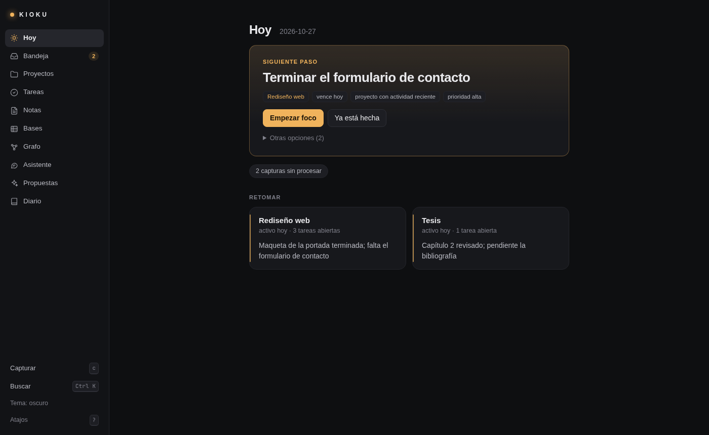
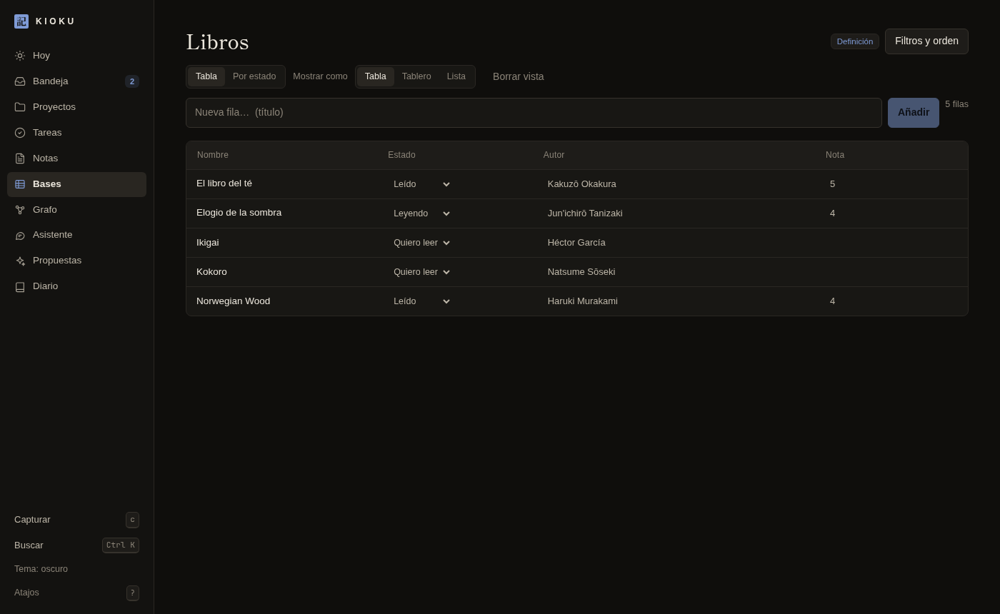
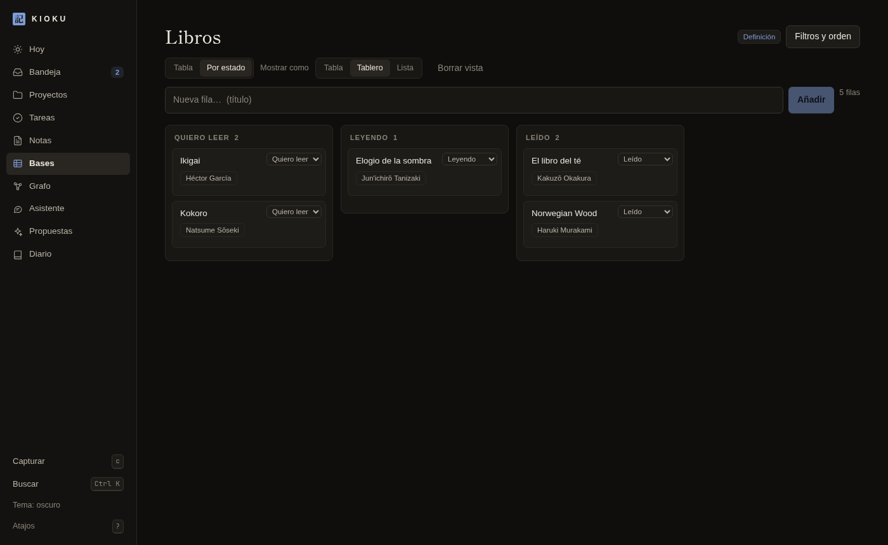
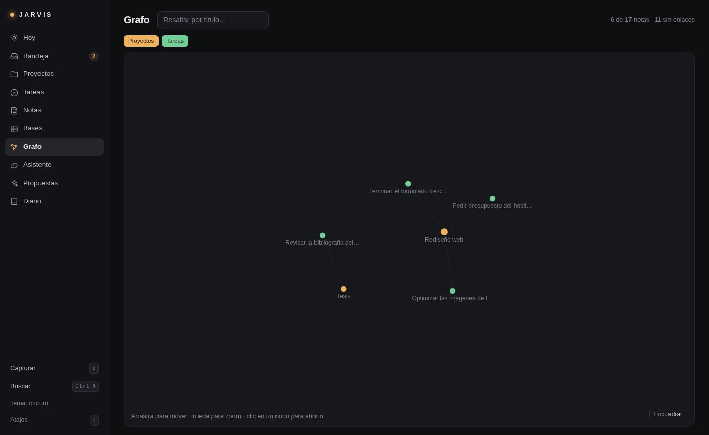

<div align="center">

# Kioku

**Tu segundo cerebro, local y tuyo.**
Notas en Markdown, tareas, proyectos y bases de datos al estilo Notion, con un asistente que propone y tú apruebas.

[](CHANGELOG.md)
[](LICENSE)
[](https://nodejs.org)
[](#privacidad-y-seguridad)
[](#desarrollo)



</div>

## Qué es

Kioku está pensado para quien ya tiene (o quiere tener) sus notas en ficheros y no quiere depender de un servicio en la nube. Resuelve tres problemas cotidianos:

| Problema | Cómo lo resuelve |
|---|---|
| *«Empiezo el día y hay demasiadas opciones.»* | La pantalla **Hoy** te dice por dónde empezar, con las razones (vence hoy, prioridad alta, proyecto activo…). |
| *«Trabajando, me desvío.»* | Las **sesiones de foco** fijan lo que haces; lo que se te ocurre va a la **Bandeja** sin cambiar de contexto. |
| *«Vuelvo tras unos días y no recuerdo dónde iba.»* | La tarjeta **Retomar** de cada proyecto: dónde lo dejaste, qué decidiste y qué falta. |

Además trae **bases de datos** (tabla, tablero y lista sobre tus propias notas), un **grafo** de enlaces y un **asistente** de IA que organiza por ti, pero nunca hace nada destructivo sin que lo apruebes.

### Principios

- **Tus datos son ficheros.** Markdown con frontmatter YAML en una carpeta. Se leen y se editan con cualquier editor (incluido Obsidian).
- **El índice es desechable.** Una base SQLite derivada que puedes borrar: se reconstruye sola desde los ficheros.
- **Local por defecto.** El servidor solo escucha en `127.0.0.1`. Sin cuentas, sin telemetría, sin nube obligatoria.
- **La IA propone, tú decides.** Todo cambio que no sea pequeño y reversible pasa por una propuesta con su diff.
- **Sin estado opaco.** Lo que «sabe» el asistente está en ficheros de texto que puedes leer y borrar.

## Capturas

<table>
  <tr>
    <td width="50%"><br><sub><b>Bases · Tabla</b> con propiedades tipadas editables en la propia celda.</sub></td>
    <td width="50%"><br><sub><b>Bases · Tablero</b>: arrastra tarjetas entre columnas y se reescribe la propiedad.</sub></td>
  </tr>
  <tr>
    <td colspan="2"><br><sub><b>Grafo</b> de enlaces entre proyectos, tareas y notas.</sub></td>
  </tr>
</table>

## Instalación

### Requisitos

| | Necesario | Para qué |
|---|---|---|
| **Node.js ≥ 24** | Sí | Ejecuta el servidor y la CLI (usa `node:sqlite`, sin dependencias nativas). |
| **Chromium, Chrome o Brave** | Recomendado | Abre la interfaz como ventana de aplicación. Sin él puedes abrir la URL del daemon en cualquier navegador. |
| **bubblewrap (`bwrap`) y [Hermes Agent](https://github.com/NousResearch/hermes-agent)** | Opcional | Solo para el asistente conversacional (ver [Asistente](#asistente)). |

Desarrollado y probado en **Arch Linux / Omarchy con Hyprland**. El Workspace funciona en cualquier Linux con Node y un navegador Chromium; la ventana flotante de captura (Quick) está pensada para Hyprland. No se ha probado en macOS ni en Windows.

### Paso a paso

```bash
# 1. Descarga el proyecto
git clone https://github.com/EzequielMenor/kioku.git
cd kioku

# 2. Instala las dependencias y compila la interfaz web
npm install
npm run build:web

# 3. (Opcional) haz el comando disponible desde cualquier carpeta
mkdir -p ~/.local/bin
ln -s "$PWD/bin/kioku" ~/.local/bin/kioku      # asegúrate de que ~/.local/bin está en tu PATH

# 4. Comprueba que funciona
kioku add "t Probar Kioku !hoy"
kioku today
kioku open                                       # abre el Workspace
kioku url                                        # URL de acceso con la clave (para abrirla en otro navegador)
```

Si no haces el paso 3, usa `bin/kioku` desde la carpeta del proyecto.

### Dónde se guardan tus datos

Por defecto en **`~/Documents/Kioku`**. Cámbialo con la variable `KIOKU_HOME`:

```bash
export KIOKU_HOME=~/mi-cerebro        # por ejemplo, en tu ~/.bashrc
```

> **Importante:** Kioku se niega a usar como carpeta de trabajo una que parezca una bóveda de Obsidian (`.obsidian`) para no modificarla. Si ya usas Obsidian, deja tu bóveda donde está e [impórtala](#importar-desde-obsidian) como copia.

### Atajo de teclado para la captura rápida (Hyprland / Omarchy)

Añade esto **tú** a `~/.config/hypr/bindings.lua` (Kioku nunca toca tu configuración). Hay un ejemplo en [`contrib/hyprland-bind.lua`](contrib/hyprland-bind.lua):

```lua
o.bind("SUPER + N",       "Kioku Quick",     "/ruta/a/kioku/bin/kioku quick")
o.bind("SUPER + ALT + N", "Kioku Workspace", "/ruta/a/kioku/bin/kioku open")
```

Comprueba antes que esas teclas estén libres con `omarchy menu keybindings --print`.

### Arranque automático (opcional)

```bash
kioku service install      # servicio de usuario de systemd; arranca con tu sesión
kioku service status
kioku service uninstall
```

## Uso

### Captura: escribir sin pensar dónde va

Pulsa tu atajo (o `c` dentro del Workspace) y escribe. El **prefijo** decide qué se crea; sin prefijo, va a la **Bandeja** para clasificarla después.

| Escribes | Resultado |
|---|---|
| `t Llamar a Ana !mañana @Tesis p1` | Tarea con fecha (`!hoy`, `!mañana`, `!viernes`…), proyecto (`@`) y prioridad (`p1`–`p3`) |
| `d Usar Markdown para el blog @[Rediseño web]` | Decisión anotada en el proyecto (si el nombre tiene espacios, entre corchetes) |
| `n Resumen de la reunión` | Nota |
| `/ presupuesto` | Búsqueda |
| `a: ¿qué hago hoy?` | Pregunta al asistente |
| *cualquier otra cosa* | Captura en la Bandeja |

Lo mismo desde la terminal, sin abrir ventana: `kioku add "t Llamar a Ana !mañana @Tesis p1"`.

### El flujo diario

1. **Hoy** (`g h`): la tarjeta *Siguiente paso* sugiere una tarea y explica por qué. `Empezar foco` la activa.
2. **Foco**: mientras dura, lo que captures queda aparcado en la Bandeja para después. Termina con `kioku focus end -m "dónde lo dejas"` (o `--done`).
3. **Retomar**: al volver a un proyecto verás *Lo dejaste en / Decidiste / Falta*.
4. **Bandeja** (`g b`): convierte las capturas en tarea o nota con un clic, o deja que las clasifique el asistente.

### Bases de datos

Entra en **Bases** (`g d`) para reunir notas como filas de una tabla. Eliges de dónde salen (una carpeta, un tipo de nota o etiquetas) y obtienes:

- **Propiedades tipadas:** texto, número, fecha, casilla, selección, selección múltiple, URL y relación. El tipo se deduce de los valores o lo fijas tú.
- **Tres vistas:** Tabla, Tablero (arrastrar y soltar entre columnas) y Lista.
- **Filtros, orden, agrupación y columnas**, y **vistas guardadas** por base.
- **Plantillas** para empezar: vacía, tareas, proyectos y libros.

Todo es Markdown: la base es `Bases/<Nombre>.md`, las filas son notas normales y cada celda es una propiedad de su frontmatter. Por eso también se ven y se editan en Obsidian o con cualquier editor. Cada nota muestra y edita sus propiedades en el panel lateral.

```yaml
# Bases/Libros.md
type: database
source: { folder: "Libros/" }
properties:
  Estado: { type: select, options: [Quiero leer, Leyendo, Leído] }
views:
  - { name: Por estado, kind: board, group: Estado }
```

### Atajos del Workspace

| Tecla | Acción |
|---|---|
| `Ctrl+K` | Paleta: buscar y ejecutar comandos |
| `c` | Capturar |
| `g h` · `g b` · `g p` · `g t` · `g n` · `g d` · `g g` · `g a` · `g r` | Ir a Hoy · Bandeja · Proyectos · Tareas · Notas · Bases · Grafo · Asistente · Propuestas |
| `?` | Ayuda de atajos |

### Importar desde Obsidian

Tu bóveda **no se toca**. La importación hace una *copia de solo lectura* del origen:

```bash
kioku import-obsidian ~/Documents/MiBoveda          # solo informa de lo que haría
kioku import-obsidian ~/Documents/MiBoveda --yes    # copia a KIOKU_HOME (en Notas/Importado/)
```

### Copias de seguridad

Tu carpeta ya es la copia de seguridad (son ficheros). Además:

```bash
kioku export ~/respaldo.tar.gz
kioku restore ~/respaldo.tar.gz ~/carpeta-nueva
```

## Asistente

Es opcional y la forma más cómoda de organizar el espacio: pídele que clasifique la Bandeja, que revise enlaces rotos o que te diga qué hacer hoy. Se abre en la pestaña **Asistente** (`g a`), con `kioku ask "…"` o con `a:` en Quick.

- **Motor:** [Hermes Agent](https://github.com/NousResearch/hermes-agent) con tu suscripción de Codex (`~/.hermes/auth.json`), dentro de una jaula `bwrap`. Comprueba tus requisitos con `kioku assistant status`.
- **Qué hace solo:** lo pequeño y reversible (clasificar capturas, consultar tus bases, añadirles filas). Cada acción queda con un botón **Deshacer** (`kioku assistant actions` · `kioku assistant undo <id>`).
- **Qué te pide aprobar:** borrar, mover o tocar más de 5 notas, o escribir contenido externo, se convierte en una **propuesta** con diff (`kioku proposals`).
- **Qué ve:** solo lo que lee a través de las herramientas de Kioku; nunca monta tu bóveda. Puedes excluir carpetas en `.kioku/assistant.json`: `{"exclude": ["Privado/"]}`. `Notas/Importado/` es de solo lectura para él.
- **Qué recuerda:** texto plano en `.kioku/hermes/` (pantalla *Memoria*); puedes borrarlo.

> El texto de las notas que el asistente lee **se envía al proveedor del modelo**. Cada consulta queda registrada con las notas leídas. Si no quieres eso, no lo actives: el resto de Kioku funciona sin él.

### IA propia (opcional)

Para triaje con tu propio modelo, local (Ollama) o remoto compatible con la API de OpenAI:

```bash
kioku ai config http://127.0.0.1:11434/v1 <modelo>        # local
kioku ai config https://api.ejemplo.com/v1 <modelo> MI_VARIABLE_CON_LA_CLAVE   # remoto
kioku ai preview          # muestra EXACTAMENTE qué se enviaría
kioku ai triage --yes     # solo entonces se envía; el resultado son propuestas
```

La clave nunca se guarda en disco: solo el nombre de la variable de entorno que la contiene.

## Referencia de la CLI

| Comando | Descripción |
|---|---|
| `quick` · `open` | Abre/oculta la captura rápida · abre el Workspace |
| `add <texto>` | Captura sin ventana (misma sintaxis que Quick) |
| `today` · `resume [proyecto]` · `search <consulta>` | Qué hacer hoy · dónde lo dejaste · buscar |
| `focus start <tarea\|@proyecto>` · `focus end [-m "…"] [--done]` | Sesión de foco |
| `context <proyecto>` | JSON con el contexto exacto que recibiría una IA |
| `proposals [apply\|reject <id>]` · `triage` | Propuestas pendientes · generar propuestas con reglas locales |
| `ai …` · `ask <mensaje>` · `assistant status\|actions\|undo` | IA opcional y asistente |
| `reindex` | Reconstruye el índice desde los ficheros |
| `export` · `restore` · `import-obsidian` | Portabilidad |
| `daemon` · `status` · `service install\|uninstall\|status` | Servidor y arranque automático |

`kioku --help` lista todo con ejemplos.

## Cómo funciona

```
 Tu carpeta (KIOKU_HOME)                  Daemon (127.0.0.1)                 Interfaz
 ┌───────────────────────┐   lee/escribe   ┌──────────────────────┐   HTTP   ┌────────────────┐
 │ Bandeja/  Tareas/     │ ◄─────────────► │ Núcleo (TypeScript)  │ ◄──────► │ Workspace      │
 │ Proyectos/ Notas/     │                 │  · parser Markdown   │  + SSE   │ (Preact)       │
 │ Bases/  Diario/ …     │                 │  · motor de bases    │          │ Quick          │
 │ .kioku/  (derivado)  │                 │  · índice SQLite/FTS5│          └────────────────┘
 └───────────────────────┘                 │  · propuestas + undo │          ┌────────────────┐
                                           └──────────┬───────────┘  MCP     │ Asistente      │
                                                      └─────────────────────►│ (Hermes, jaula)│
                                                          herramientas       └────────────────┘
```

- **Fuente de verdad:** los `.md`. Escrituras atómicas con comprobación de hash: si editas un fichero fuera de Kioku, no se pisa en silencio.
- **Índice:** `.kioku/index.db` (SQLite + FTS5). Es una caché: bórralo o ejecuta `kioku reindex` y se reconstruye igual.
- **Daemon:** servidor HTTP local con control de `Host`/`Origin`, que reparte la interfaz y una API JSON con eventos en tiempo real (SSE).
- **Asistente:** habla con el núcleo solo a través de herramientas con permisos por niveles que **impone el servidor**, no el modelo.

Diseño completo en [`docs/design`](docs/design) (PRD, arquitectura y decisiones, UX, flujos, modelo de datos y especificación del asistente).

## Privacidad y seguridad

- Todo se queda en tu máquina. No hay telemetría ni cuentas.
- El servidor solo escucha en `127.0.0.1`; las peticiones con `Host` u `Origin` ajenos se rechazan.
- Las escrituras de la IA pasan por propuestas, o por acciones reversibles con Deshacer, y quedan auditadas.
- Tu bóveda de Obsidian nunca se modifica: la importación es una copia.
- **La API del daemon exige una clave.** Al arrancar crea `.kioku/secret` (0600, no se incluye en las copias de seguridad) y toda ruta `/api` la pide, lecturas incluidas, por cookie (`HttpOnly`, `SameSite=Strict`) o cabecera `x-kioku-key`. `kioku open`, `kioku quick` y los atajos la llevan solos; `kioku url` imprime una URL de acceso para abrirla a mano. Así, aunque la jaula del asistente comparta la red del equipo (Hermes necesita llegar a su proveedor), no puede leer ni cambiar tus notas saltándose las herramientas con token de sesión. Límite: otro proceso de tu mismo usuario que pueda leer `.kioku/secret` sí puede usar la API (es el mismo nivel de acceso que ya tiene a tus ficheros).

## Desarrollo

```bash
npm test               # 144 pruebas (node:test), todas sobre bóvedas temporales
npm run typecheck      # tsc --noEmit
npm run build:web      # empaqueta la interfaz con esbuild en dist/web
npm run dev            # daemon en primer plano
```

Pila: Node 24 (TypeScript nativo, `node:sqlite`), Preact, CodeMirror 6, esbuild. Dependencias de ejecución mínimas y fijadas (`yaml`, `preact`, `@codemirror/*`).

Las pruebas y la validación manual usan siempre carpetas temporales (`KIOKU_HOME`); nunca tocan datos reales. Resultados y límites conocidos en [`docs/validation.md`](docs/validation.md).

## Hoja de ruta

Ideas siguientes, sin orden de compromiso:

- Vistas **Calendario** y **Galería** para las bases.
- Relaciones entre bases, *rollups* y fórmulas.
- Plantillas de fila y creación de bases desde el asistente.
- Autenticación de la API local y red aislada para la jaula del asistente.

## Versiones

Consulta el [CHANGELOG](CHANGELOG.md). Versión actual: **0.4.0**.

## Licencia

[MIT](LICENSE) © 2026 Ezequiel
